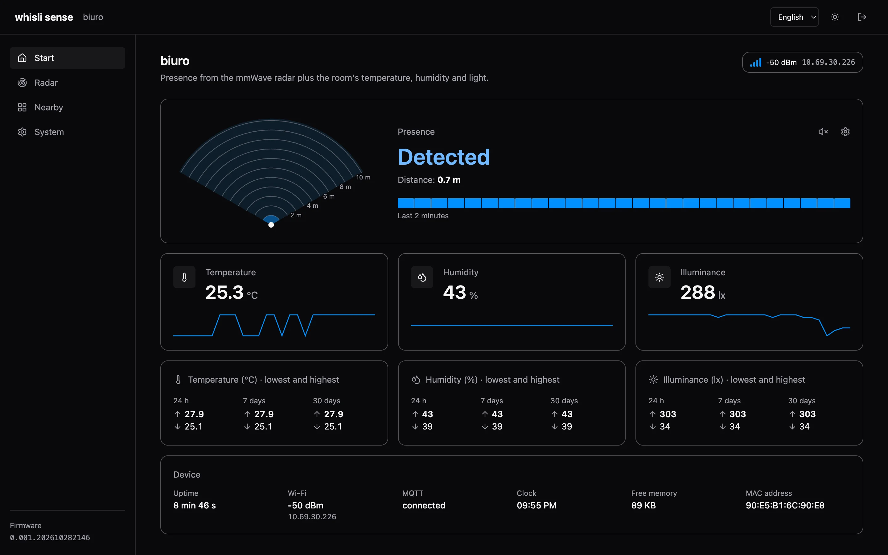
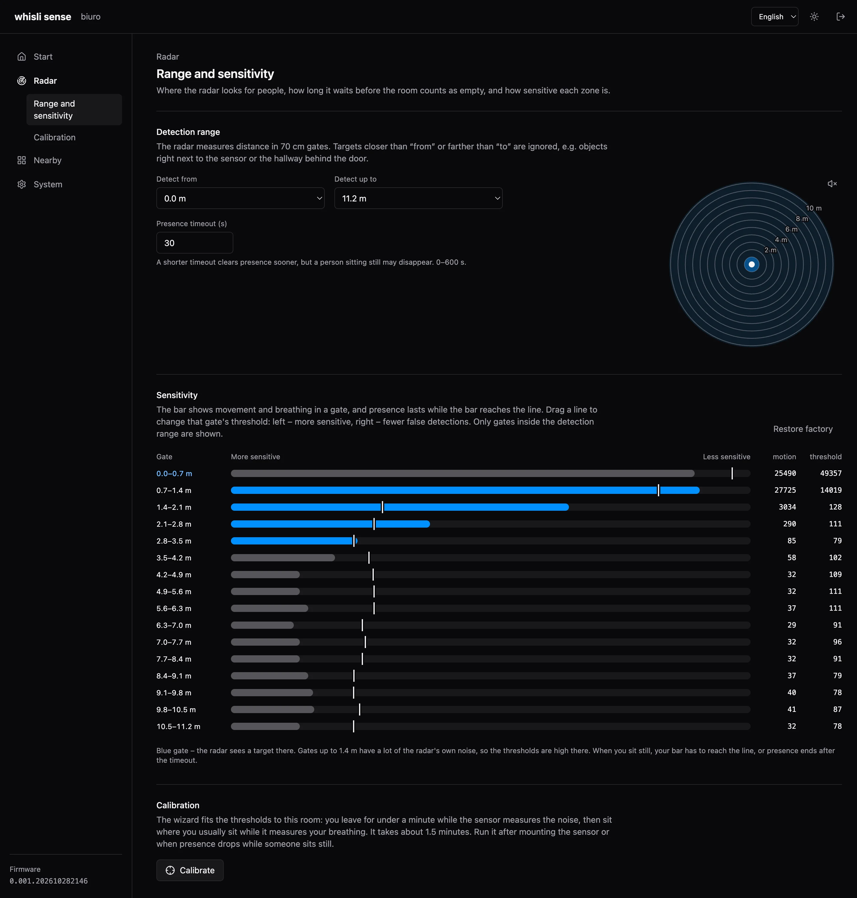
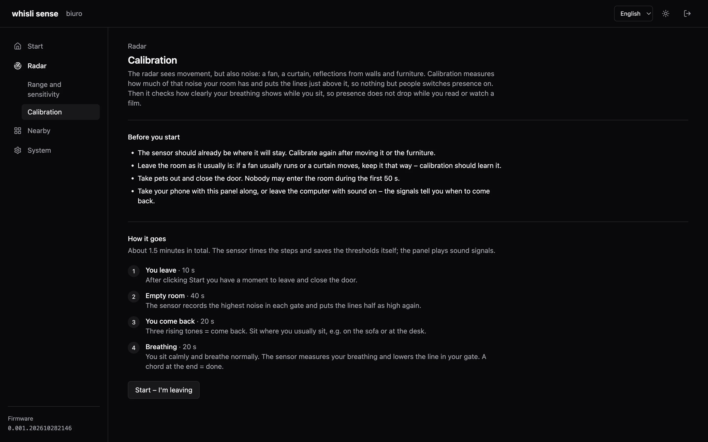
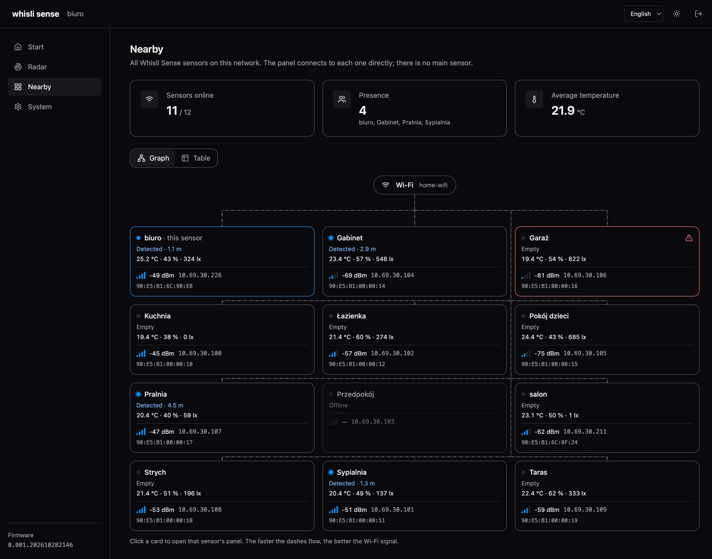
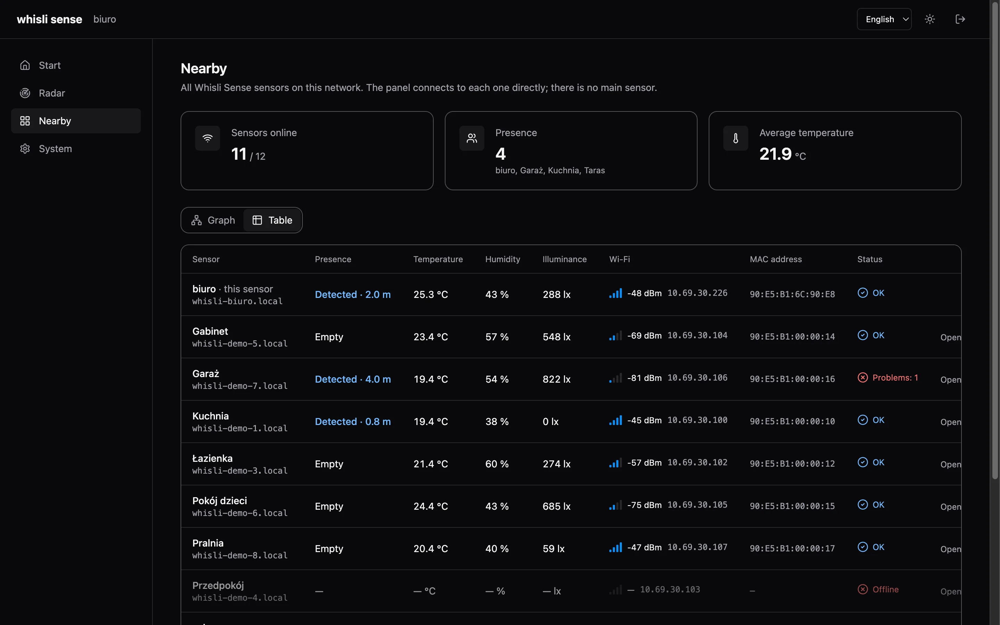
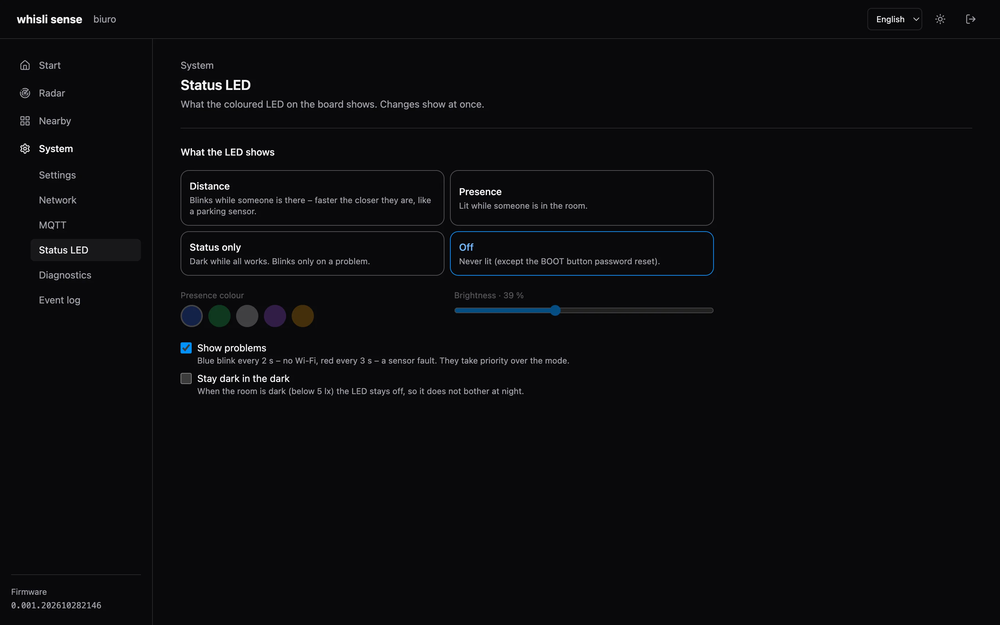
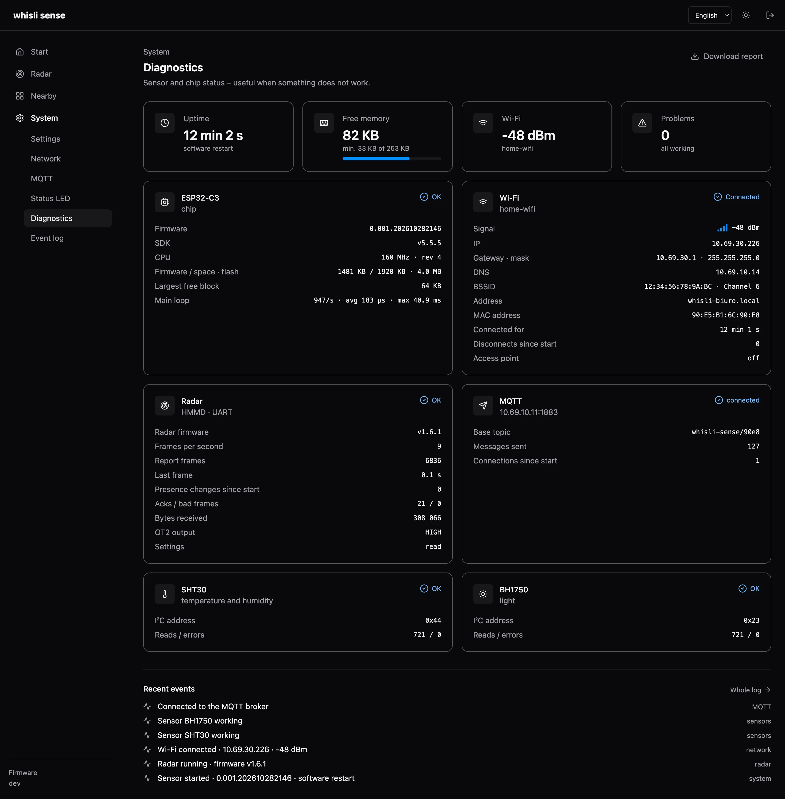

<div align="right"><a href="README.pl.md">Polski</a> · <b>English</b></div>

# whisli sense

A presence sensor for the home that also sees a person sitting still. Its mmWave radar picks up even
breathing, and next to it the sensor measures temperature, humidity and light. It runs on its own
over Wi-Fi, has its own panel in the browser and, if you want, announces itself to Home Assistant.



## Concept

- **Presence, not motion.** A regular PIR sensor turns the light off while you read or watch a film.
  The mmWave radar sees the tiny movements of breathing, so presence lasts as long as someone is there.
- **Everything local.** No cloud, no accounts, no internet. Every sensor has its own panel and API;
  Home Assistant over MQTT is an extra, not a requirement.
- **No hub.** Sensors find each other on the network (mDNS). The panel of any of them shows all of
  them – none is the "main" one, so one failing does not take the others down.
- **Fitted to the room.** A 1.5-minute calibration measures the empty room's noise and a sitting
  person's breathing, then sets the thresholds of every radar gate by itself.
- **Everything through the API.** Every panel feature is available through a simple JSON API, so the
  sensor fits into any system.
- **Simple.** Small, readable code: C++ firmware (Arduino on ESP-IDF) and a React panel built into the
  firmware – one file to flash.

## Hardware

| Part | Model | Role |
|---|---|---|
| Microcontroller | Waveshare **ESP32-C3-Zero** (RISC-V 160 MHz, 4 MB flash, 2.4 GHz Wi-Fi, USB-C, WS2812 RGB LED) | firmware, Wi-Fi, web panel, status LED |
| Radar | Waveshare **HMMD mmWave** (S3KM1110 chip, 24 GHz) | presence and distance, energy in 16 gates of 70 cm (up to 11.2 m) |
| Temperature and humidity | Sensirion **SHT30** (I²C) | room climate |
| Light | ROHM **BH1750** (I²C) | illuminance in lux |

Powered over USB-C (5 V); the modules run from the board's 3.3 V. Wiring is in the
[technical documentation](#hardware-and-wiring).

## Features

### Start – live presence

A top view of the radar with a wave "searching" for the person, the distance, a 2-minute presence
timeline, temperature, humidity and light with charts, plus the minimum and maximum over 24 h, 7 and
30 days. Optional beeping like a parking sensor – the closer the person, the faster.

### Radar – range and sensitivity

Detection range (from – to) and the presence timeout. For each of the 16 gates you see live motion
against its threshold; drag the line to change the threshold. Everything saves by itself.



### Calibration

The wizard guides you with text, sound and a radar animation: you leave for a moment (noise), come
back and sit down (breathing). The sensor times the steps and saves the thresholds; the previous ones
are one click away.



### Nearby – all sensors on the network

A graph or a table of all sensors: presence, climate, Wi-Fi strength, IP and MAC. The panel connects
to each sensor directly. The screenshots show two real sensors and ten from the panel's demo mode.





### Status LED

Blinking by distance, lit while someone is there, problems only, or off. Plus colour, brightness and
staying dark at night (light sensor).



### Diagnostics and event log

Chip, memory, Wi-Fi, radar, sensors and MQTT status, the latest events and a one-click report
download. A separate page has the full event log with filters.



### More

- **Home Assistant (MQTT Discovery)** – the sensor creates its own device with entities: occupancy,
  distance, temperature, humidity, illuminance, Wi-Fi signal.
- **First setup without a cable** – without Wi-Fi the sensor opens its own access point with the setup panel.
- **Panel password** – sign-in with "remember me for 30 days", HTTP Basic for scripts, reset with the BOOT button.
- **Updates over Wi-Fi** – new firmware from the panel or with a single `curl` command.
- **Two languages, two themes** – Polish and English, light and dark.

## Quick start

1. Power it up. A new sensor opens the Wi-Fi network **Whisli-Sense-XXXX** (password `whisli_gogo`).
2. Join it and open `http://192.168.4.1/`. Panel password: `whisli_gogo`.
3. **System → Network**: pick your Wi-Fi and connect. The sensor will be at `http://whisli-<name>.local/`.
4. **System → Settings**: give it a name (e.g. "Living room") and change the password.
5. **Radar → Calibration**: fit the sensitivity to the room (about 1.5 minutes).

Holding the BOOT button for 10 s restores the default panel password.

### LED

Dark by default while all is well. Problems: blue blink every 2 s – no Wi-Fi, red every 3 s – a
sensor fault. Fast white – BOOT is held. Other modes: **System → Status LED**.

---

# Technical documentation

## Hardware and wiring

All modules are powered from the board's 3V3 and GND.

| Signal | GPIO |
|---|---|
| I²C SDA / SCL (SHT30 0x44, BH1750 0x23) | 4 / 5 |
| Radar TX → ESP RX | 6 |
| ESP TX → Radar RX | 7 |
| Radar OT2 (presence) | 3 |
| WS2812 LED (on the board) | 10 |
| BOOT (on the board) | 9 |

## Building

Needs [PlatformIO](https://platformio.org/) and Node.js.

```
cd ui && npm install && cd ..
pio run                      # builds the panel (ui/) and the firmware
pio run -t upload            # over USB (always USB when the partition table changes)
WHISLI_SENSE_PASSWORD=<password> pio run -e ota -t upload --upload-port whisli-salon.local
```

`scripts/prebuild.py` builds the panel, gzips it into `src/generated/ui.h` and stamps the version
`0.001.YYYYMMDDHHMM`, shared by firmware and panel. `WHISLI_SENSE_SKIP_UI=1 pio run` skips the panel
(faster firmware-only builds).

Panel against a live sensor, with live reload: `cd ui && SENSE_DEVICE_URL=http://<sensor ip> npm run dev`.
In this mode `http://localhost:5173/?demo=10#/sensors` adds 10 made-up sensors.

To have a board join Wi-Fi straight away, copy `src/local_defaults.example.h` to
`src/local_defaults.h` and fill in the network. The file is not committed.

## Minimum and maximum

The sensor keeps the lowest and highest temperature, humidity and light over the last 24 h, 7 and 30
days (`extremes.day` / `week` / `month` in the state). It stores 24 hourly and 30 daily buckets in NVS
(`sense-extremes`), saved every 10 minutes and before every restart from the panel or API (also after
OTA) – a sudden power cut loses at most 10 minutes. Time is taken from the clock (SNTP,
`pool.ntp.org`), so the time the sensor was off counts too; without internet only uptime counts. A
day is 24 hours of running since the first save, not a calendar day.

## API

Everything the panel does is available through the API under `/api/v1`. POST takes form fields,
answers are JSON, errors `{"error":"<code>"}`. Access: the panel session or HTTP Basic
(`curl -u whisli:<password> …`).

| Method and path | What it does |
|---|---|
| `GET /api/v1/state` | full state: presence, distance, climate, min/max of temperature, humidity and light (`extremes`), radar (thresholds, energy), calibration, problems, Wi-Fi (`rssi`, `ip`, `mac`), `heap`, clock (`clock`, Unix time from NTP or `null`) |
| `ws://…/api/v1/ws` | the same every second and at once when presence changes |
| `ws://…/api/v1/live` | short summary for the sensors overview (with `rssi`, `ip`, `mac`), every 10 s; **no sign-in** |
| `GET /api/v1/peers` | this sensor and the others found on the network (mDNS `_whisli-sense._tcp`) |
| `POST /api/v1/device` | `name` (1–32 characters); the hostname is made from it |
| `POST /api/v1/radar` | `minGate`, `maxGate` (0–15, gate = 70 cm), `delay` (0–600 s), `p0`…`p15` (presence threshold: hold = p, trigger = 1.5 × p), `t0`…`t15` / `h0`…`h15` (raw thresholds, 0–65535), `factory=1` |
| `POST /api/v1/calibration` | `action`: `start` (optional `leave`, `empty`, `back`, `still` in s, `margin` in %), `seated`, `cancel`, `undo` |
| `GET/POST /api/v1/wifi` | network status / `ssid`, `password` – connect |
| `POST /api/v1/wifi/forget` | forget the network (opens the access point) |
| `POST`, `GET /api/v1/wifi/scan` | scan / results |
| `POST /api/v1/wifi/ap` | `password` – access point password |
| `GET/POST /api/v1/mqtt` | MQTT settings: `enabled`, `host`, `port`, `user`, `password`, `clearPassword`, `baseTopic`, `discovery`, `discoveryPrefix` |
| `GET/POST /api/v1/led` | LED: `mode` (`off`, `status`, `presence`, `distance` – blinks faster the closer the person), `color` (`blue`, `green`, `white`, `purple`, `amber`), `brightness` (1–100 %), `alerts`, `darkOff` (stay dark in the dark) |
| `GET /api/v1/logs` | event log (RAM, up to 120 entries): `after`, `before` (entry id), `limit`, `level`, `category` |
| `GET /api/v1/system` | version, memory, uptime, reset reason |
| `GET /api/v1/diagnostics` | sensors, radar, chip (memory, flash, main loop), Wi-Fi, MQTT |
| `POST /api/v1/system/restart` | restart |
| `POST /api/v1/firmware` | new firmware as the raw body (`application/octet-stream`) |
| `GET /api/v1/auth`, `POST /api/v1/auth/login`, `…/logout`, `…/password` | `GET` without sign-in: signed in or not, plus the sensor's name, hostname and IP (for the login screen); sign-in (`password`, `remember=1` – a 30-day session that survives restarts), password change (`current`, `password`) |

## Radar

Report mode: about 10 frames a second with presence, distance and the energy in 16 gates of 70 cm.
Each gate has two thresholds in the radar: **trigger** (motion) and **hold** (micro-motion, breathing).
Presence starts above the trigger and lasts while the energy stays above hold, plus the timeout. The
panel shows one "presence threshold" (hold) and keeps the trigger 1.5× higher. The settings live in
the radar; when it stops sending (e.g. after a power cut), the firmware sets report mode again and
reads the settings back.

Calibration: noise = maximum energy in the empty room; "person" = 20th percentile of the per-second
maxima while sitting. Gate with the person (≥ 1.3 × noise): hold = noise × (person/noise)^0.4 (at least
noise × 1.15), trigger = hold × 1.5. Other gates: hold = noise × (1 + margin), trigger = hold × (1 + margin).

## MQTT (Home Assistant)

One device in HA (`whisli_sense_<id>`, `<id>` = last MAC bytes) with entities: Occupancy, Distance,
Temperature, Humidity, Illuminance, Wi-Fi signal (entity names are in Polish).

| Topic | Payload |
|---|---|
| `whisli-sense/<id>/status` | `online` / `offline` (retained, last will) |
| `whisli-sense/<id>/state` | `{"occupancy":"ON","distance":2.05,"temperature":24.9,"humidity":47,"lux":62,"rssi":-52}` |

Presence changes are sent at once; distance, climate and light at most every 2 s and only on change;
otherwise the state goes out every minute.
