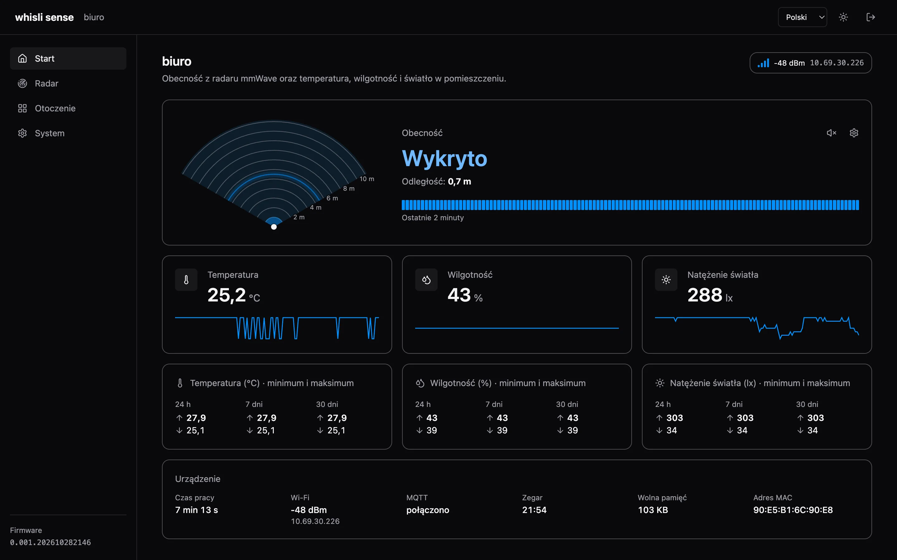
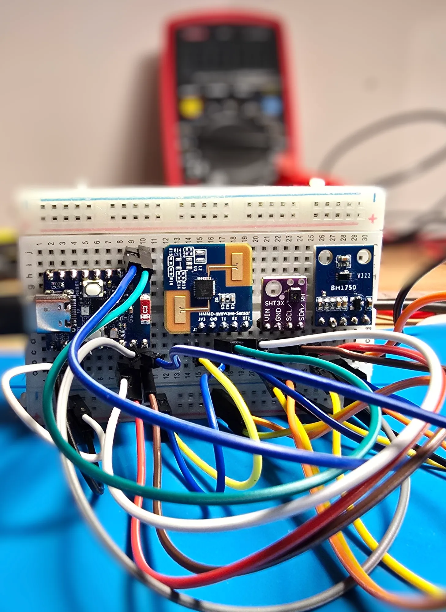
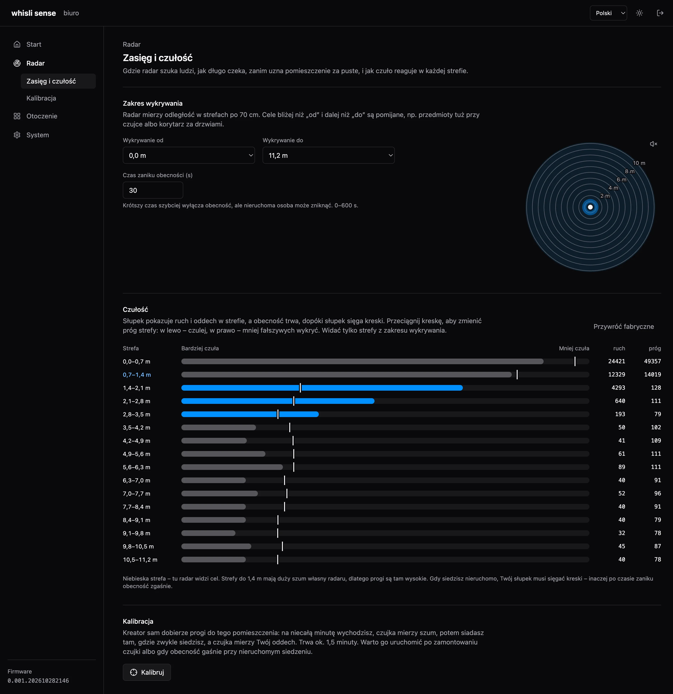
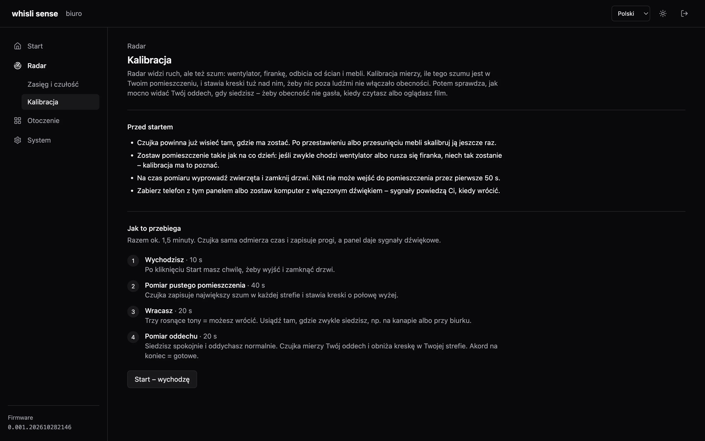
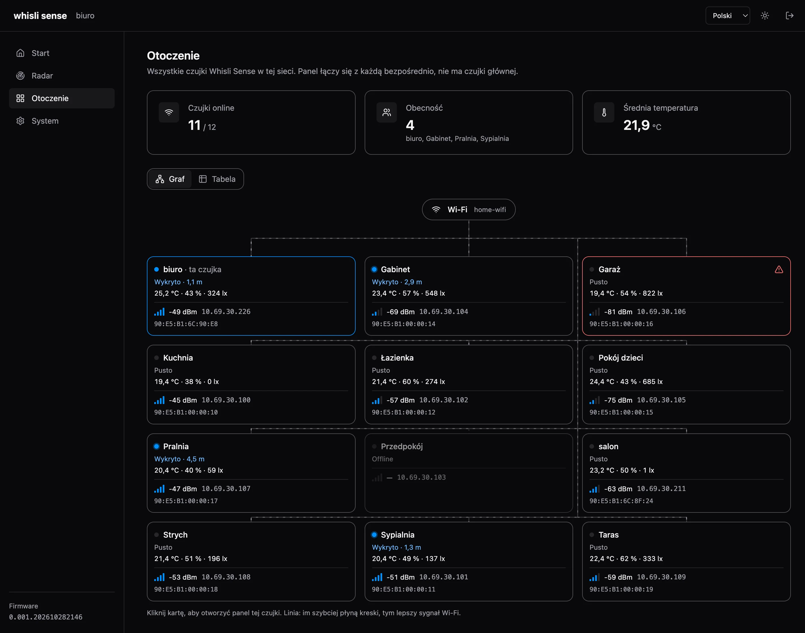
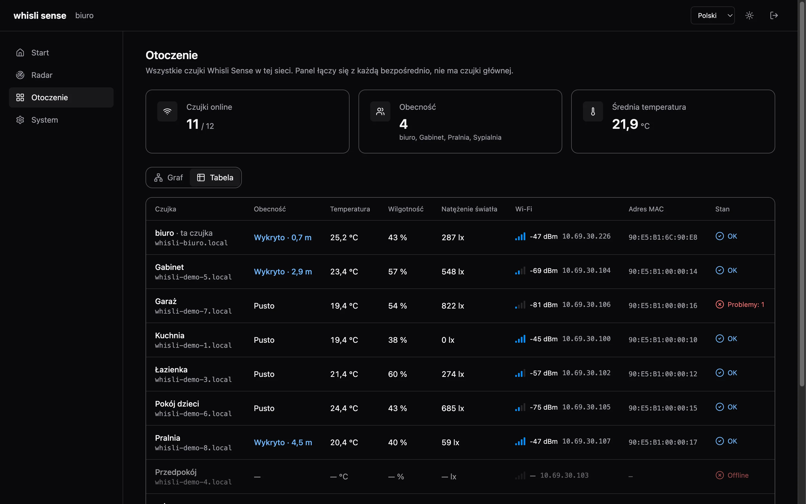
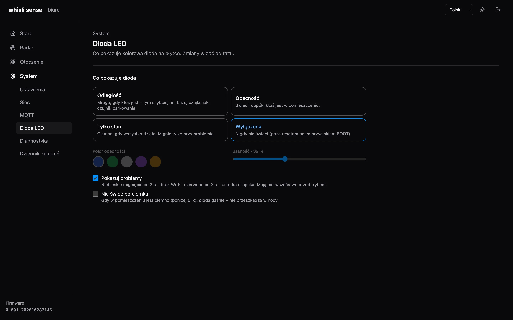
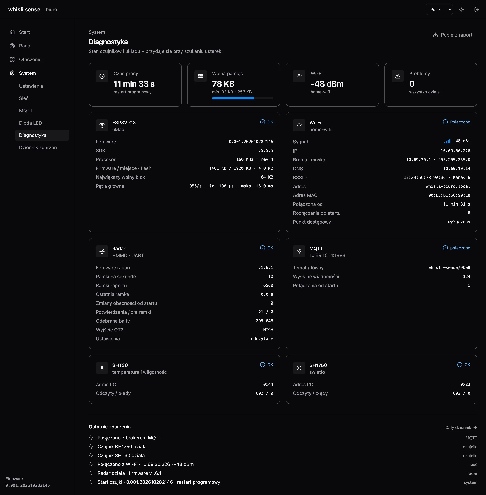

<div align="right"><b>Polski</b> · <a href="README.md">English</a></div>

# whisli sense

Czujka obecności do domu, która widzi także osobę siedzącą nieruchomo. Radar mmWave wyczuwa nawet
oddech, a obok mierzy temperaturę, wilgotność i natężenie światła. Działa samodzielnie w sieci Wi-Fi,
ma własny panel w przeglądarce i – jeśli chcesz – sama ogłasza się w Home Assistancie.



## Koncepcja

- **Obecność, a nie ruch.** Zwykła czujka PIR gasi światło, gdy czytasz albo oglądasz film. Radar
  mmWave widzi mikroruchy klatki piersiowej, więc obecność trwa, dopóki ktoś jest w pomieszczeniu.
- **Wszystko lokalnie.** Bez chmury, kont i internetu. Każda czujka ma własny panel i API; Home
  Assistant przez MQTT jest dodatkiem, nie warunkiem.
- **Bez centrali.** Czujki znajdują się nawzajem w sieci (mDNS). Panel dowolnej z nich pokazuje
  wszystkie – żadna nie jest „główna”, więc awaria jednej nie wyłącza pozostałych.
- **Dopasowana do pomieszczenia.** Kalibracja w 1,5 minuty mierzy szum pustego pomieszczenia i oddech
  siedzącej osoby, a potem sama ustawia progi każdej strefy radaru.
- **Wszystko przez API.** Każda funkcja panelu jest dostępna przez proste API JSON, więc czujkę można
  wpiąć w dowolny system.
- **Prosto.** Mały, czytelny kod: firmware w C++ (Arduino na ESP-IDF) i panel w React wbudowany w
  firmware – jeden plik do wgrania.

## Podzespoły

| Element | Model | Rola |
|---|---|---|
| Mikrokontroler | Waveshare **ESP32-C3-Zero** (RISC-V 160 MHz, 4 MB flash, Wi-Fi 2,4 GHz, USB-C, dioda RGB WS2812) | firmware, Wi-Fi, panel WWW, dioda statusu |
| Radar | Waveshare **HMMD mmWave** (układ S3KM1110, 24 GHz) | obecność i odległość, energia w 16 strefach po 70 cm (do 11,2 m) |
| Temperatura i wilgotność | Sensirion **SHT30** (I²C) | klimat w pomieszczeniu |
| Światło | ROHM **BH1750** (I²C) | natężenie światła w luksach |

Zasilanie przez USB-C (5 V), moduły z 3,3 V płytki. Schemat połączeń jest w
[dokumentacji technicznej](#sprzęt-i-połączenia).

<p align="center">
  <br>
  <sub>Prototyp na płytce stykowej – od lewej: ESP32-C3-Zero, radar HMMD mmWave, SHT3x, BH1750.</sub>
</p>

## Funkcje

### Start – obecność na żywo

Widok radaru z góry z falą, która „szuka” osoby, odległość, oś obecności z ostatnich 2 minut,
temperatura, wilgotność i światło z wykresami oraz minimum i maksimum z 24 h, 7 i 30 dni. Opcjonalne
pikanie jak czujnik parkowania – im bliżej osoba, tym częściej.

### Radar – zasięg i czułość

Zakres wykrywania (od – do) i czas zaniku obecności. Dla każdej z 16 stref widać na żywo ruch na tle
progu; próg zmienia się, przeciągając kreskę. Wszystko zapisuje się samo.



### Kalibracja

Kreator prowadzi tekstem, dźwiękiem i animacją radaru: wychodzisz na chwilę (pomiar szumu), wracasz
i siadasz (pomiar oddechu). Czujka sama odmierza kroki i zapisuje progi; poprzednie można przywrócić
jednym kliknięciem.



### Otoczenie – wszystkie czujki w sieci

Graf albo tabela wszystkich czujek: obecność, klimat, siła Wi-Fi, IP i MAC. Panel łączy się z każdą
czujką bezpośrednio. Na zrzutach dwie prawdziwe czujki i dziesięć z trybu demo panelu.





### Dioda LED

Mruganie zależne od odległości, świecenie przy obecności, sama sygnalizacja problemów albo
wyłączona. Do tego kolor, jasność i wygaszanie po ciemku (czujnik światła).



### Diagnostyka i dziennik zdarzeń

Stan układu, pamięci, Wi-Fi, radaru, czujników i MQTT, ostatnie zdarzenia oraz raport do pobrania
jednym kliknięciem. Osobna strona z pełnym dziennikiem zdarzeń i filtrami.



### Pozostałe

- **Home Assistant (MQTT Discovery)** – czujka sama tworzy urządzenie z encjami: obecność, odległość,
  temperatura, wilgotność, jasność, sygnał Wi-Fi.
- **Pierwsze uruchomienie bez kabla** – bez Wi-Fi czujka otwiera własny punkt dostępowy z panelem
  konfiguracji.
- **Hasło panelu** – logowanie z opcją „zapamiętaj na 30 dni”, HTTP Basic dla skryptów, reset
  przyciskiem BOOT.
- **Aktualizacje przez Wi-Fi** – nowy firmware wgrywa się z panelu albo jednym poleceniem `curl`.
- **Dwa języki i dwa motywy** – polski i angielski, jasny i ciemny.

## Szybki start

1. Podłącz zasilanie. Nowa czujka otwiera sieć Wi-Fi **Whisli-Sense-XXXX** (hasło `whisli_gogo`).
2. Połącz się z nią i otwórz `http://192.168.4.1/`. Hasło panelu: `whisli_gogo`.
3. **System → Sieć**: wybierz swoją sieć Wi-Fi i połącz. Czujka będzie pod `http://whisli-<nazwa>.local/`.
4. **System → Ustawienia**: nadaj nazwę (np. „Salon”) i zmień hasło.
5. **Radar → Kalibracja**: dopasuj czułość do pomieszczenia (ok. 1,5 minuty).

Przytrzymanie przycisku BOOT przez 10 s przywraca domyślne hasło panelu.

### Dioda

Domyślnie ciemna, gdy wszystko działa. Problemy: niebieskie mignięcie co 2 s – brak Wi-Fi,
czerwone co 3 s – usterka czujnika. Szybkie białe – trzymasz BOOT. Inne tryby: **System → Dioda LED**.

---

# Dokumentacja techniczna

## Sprzęt i połączenia

Wszystkie moduły zasilane z 3V3 i GND płytki.

| Sygnał | GPIO |
|---|---|
| I²C SDA / SCL (SHT30 0x44, BH1750 0x23) | 4 / 5 |
| Radar TX → ESP RX | 6 |
| ESP TX → Radar RX | 7 |
| Radar OT2 (obecność) | 3 |
| Dioda WS2812 (na płytce) | 10 |
| BOOT (na płytce) | 9 |

## Budowanie

Potrzebne: [PlatformIO](https://platformio.org/) i Node.js.

```
cd ui && npm install && cd ..
pio run                      # buduje panel (ui/) i firmware
pio run -t upload            # przez USB (przy zmianie tablicy partycji zawsze USB)
WHISLI_SENSE_PASSWORD=<hasło> pio run -e ota -t upload --upload-port whisli-salon.local
```

`scripts/prebuild.py` buduje panel, pakuje go gzipem do `src/generated/ui.h` i nadaje wersję
`0.001.RRRRMMDDGGMM`, wspólną dla firmware i panelu. `WHISLI_SENSE_SKIP_UI=1 pio run` pomija budowanie
panelu (szybszy build samego firmware).

Panel na żywej czujce, z podglądem zmian: `cd ui && SENSE_DEVICE_URL=http://<ip czujki> npm run dev`.
Adres `http://localhost:5173/?demo=10#/sensors` dokłada w tym trybie 10 udawanych czujek.

Jeśli płytka ma od razu połączyć się z Wi-Fi, skopiuj `src/local_defaults.example.h` do
`src/local_defaults.h` i wpisz sieć. Plik nie trafia do gita.

## Minimum i maksimum

Czujka pamięta najniższą i najwyższą temperaturę, wilgotność i natężenie światła z ostatnich 24 h, 7 i 30 dni
(`extremes.day` / `week` / `month` w stanie). Trzyma 24 kubełki godzinowe i 30 dobowych w NVS
(`sense-extremes`), zapis co 10 min i przed każdym restartem z panelu lub API (też po OTA) – nagły
zanik zasilania gubi najwyżej 10 min. Upływ godzin liczy z zegara
(SNTP, `pool.ntp.org`), więc czas, gdy czujka była wyłączona, też się liczy. Bez internetu liczy
tylko czas pracy. Doba to 24 godziny pracy od pierwszego zapisu, nie doba kalendarzowa.

## API

Wszystko, co robi panel, jest dostępne przez API pod `/api/v1`. POST przyjmuje pola formularza,
odpowiedzi są w JSON, błędy jako `{"error":"<kod>"}`. Dostęp: sesja z panelu albo HTTP Basic
(`curl -u whisli:<hasło> …`).

| Metoda i ścieżka | Co robi |
|---|---|
| `GET /api/v1/state` | pełny stan: obecność, odległość, klimat, min/max temperatury, wilgotności i światła (`extremes`), radar (progi, energia), kalibracja, problemy, Wi-Fi (`rssi`, `ip`, `mac`), `heap`, zegar (`clock`, czas uniksowy z NTP albo `null`) |
| `ws://…/api/v1/ws` | to samo co sekundę i od razu przy zmianie obecności |
| `ws://…/api/v1/live` | skrót dla widoku czujek (z `rssi`, `ip`, `mac`), co 10 s; **bez logowania** |
| `GET /api/v1/peers` | ta czujka i inne znalezione w sieci (mDNS `_whisli-sense._tcp`) |
| `POST /api/v1/device` | `name` – nazwa (1–32 znaki); z niej hostname |
| `POST /api/v1/radar` | `minGate`, `maxGate` (0–15, strefa = 70 cm), `delay` (0–600 s), `p0`…`p15` (próg obecności: podtrzymanie = p, wykrycie = 1,5 × p), `t0`…`t15` / `h0`…`h15` (progi wprost, 0–65535), `factory=1` |
| `POST /api/v1/calibration` | `action`: `start` (opcjonalnie `leave`, `empty`, `back`, `still` w s, `margin` w %), `seated`, `cancel`, `undo` |
| `GET/POST /api/v1/wifi` | stan sieci / `ssid`, `password` – połącz |
| `POST /api/v1/wifi/forget` | zapomnij sieć (otwiera punkt dostępowy) |
| `POST`, `GET /api/v1/wifi/scan` | szukaj sieci / wyniki |
| `POST /api/v1/wifi/ap` | `password` – hasło punktu dostępowego |
| `GET/POST /api/v1/mqtt` | ustawienia MQTT: `enabled`, `host`, `port`, `user`, `password`, `clearPassword`, `baseTopic`, `discovery`, `discoveryPrefix` |
| `GET/POST /api/v1/led` | dioda: `mode` (`off`, `status`, `presence`, `distance` – mruganie tym szybsze, im bliżej osoba), `color` (`blue`, `green`, `white`, `purple`, `amber`), `brightness` (1–100 %), `alerts`, `darkOff` (nie świeć po ciemku) |
| `GET /api/v1/logs` | dziennik zdarzeń (RAM, do 120 wpisów): `after`, `before` (id wpisu), `limit`, `level`, `category` |
| `GET /api/v1/system` | wersja, pamięć, czas pracy, przyczyna startu |
| `GET /api/v1/diagnostics` | czujniki, radar, układ (pamięć, flash, pętla główna), Wi-Fi, MQTT |
| `POST /api/v1/system/restart` | restart |
| `POST /api/v1/firmware` | nowy firmware jako surowe body (`application/octet-stream`) |
| `GET /api/v1/auth`, `POST /api/v1/auth/login`, `…/logout`, `…/password` | `GET` bez logowania: czy zalogowano oraz nazwa, hostname i IP czujki (dla ekranu logowania); logowanie (`password`, `remember=1` – sesja na 30 dni, przeżywa restart), zmiana hasła (`current`, `password`) |

## Radar

Tryb raportu: ok. 10 ramek na sekundę z obecnością, odległością i energią w 16 strefach po 70 cm.
Każda strefa ma w radarze dwa progi: **wykrycie** (ruch) i **podtrzymanie** (mikroruch, oddech).
Obecność zaczyna się nad progiem wykrycia i trwa nad progiem podtrzymania, plus czas zaniku. Panel
pokazuje jeden „próg obecności” (podtrzymanie), a wykrycie ustawia 1,5 raza wyżej.
Ustawienia są zapisane w radarze. Gdy radar przestanie wysyłać dane (np. po zaniku zasilania),
firmware sam ustawia tryb raportu i odczytuje ustawienia od nowa.

Kalibracja: szum = maks. energia w pustym pomieszczeniu; „osoba” = 20. percentyl maksimów z każdej sekundy
siedzenia. Strefa z osobą (≥ 1,3 × szum): podtrzymanie = szum × (osoba/szum)^0,4 (min. szum × 1,15),
wykrycie = podtrzymanie × 1,5. Pozostałe: podtrzymanie = szum × (1 + zapas), wykrycie = podtrzymanie × (1 + zapas).

## MQTT (Home Assistant)

Jedno urządzenie w HA (`whisli_sense_<id>`, `<id>` = końcówka MAC) z encjami: Occupancy, Distance,
Temperature, Humidity, Illuminance, Wi-Fi signal (nazwy po angielsku niezależnie od języka panelu;
w HA można je zmienić).

| Temat | Treść |
|---|---|
| `whisli-sense/<id>/status` | `online` / `offline` (retained, last will) |
| `whisli-sense/<id>/state` | `{"occupancy":"ON","distance":2.05,"temperature":24.9,"humidity":47,"lux":62,"rssi":-52}` |

Zmiana obecności idzie od razu; odległość, klimat i światło najwyżej co 2 s i tylko przy zmianie;
poza tym stan co minutę.
